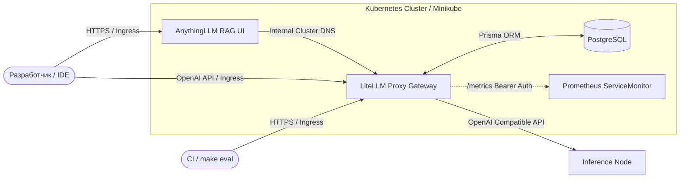

# Kubernetes LLM Gateway & RAG Stack (LiteLLM + AnythingLLM + Promptfoo)

Пет-проект по построению отказоустойчивой и наблюдаемой инфраструктуры для локального инференса LLM-моделей. 
Проект имитирует продуктивную архитектуру с разделением вычислительного и сервисного слоев.
Подходит для развертывания корпоративного AI-шлюза, RAG-интерфейса и автоматизированного контура оценки качества моделей на базе кластера Kubernetes и выделенного узла инференса.

## Архитектура стенда



### Ключевые архитектурные решения
* **Единый источник истины (Single Source of Truth):** Конфигурация маршрутизации, параметры инференса и секреты управляются централизованно через `bases/`. Релиз `AnythingLLM` автоматически вычисляет внутренний FQDN сервиса `LiteLLM` (`http://<service-name>.<namespace>.svc.cluster.local:4000/v1`), имя активной модели и API-ключ без дублирования кода. Автотесты `Promptfoo` также автоматически извлекают целевую модель из конфига окружения.
* **Безопасность и изоляция секретов:** Чувствительные данные (включая URL, ключи и имя модели инференса) вынесены в `bases/private/` (исключены из Git) и пробрасываются в кластер через Kubernetes `Secrets` (`litellm-resources`, `anythingllm-secrets`). Подключена детерминированная генерация ключей шифрования (`SIG_KEY` / `SIG_SALT`) и единая база учетных данных для шлюза, PostgreSQL и Prometheus.
* **Надежность жизненного цикла (Cold Start & Production Readiness):** В `LiteLLM` настроено ожидание готовности БД через `initContainer`, защита от гонки миграций (`migrationJob` для внешней БД и авто-синхронизация схемы Prisma для локальной БД) и переключатель `externalDb.enabled` для перехода со встроенного PostgreSQL на внешний управляемый кластер в продакшене.
* **Оптимизация под ограниченные ресурсы:** Для локального стенда применена стратегия обновления `Recreate` (для томов `ReadWriteOnce`), включены встроенные локальные эмбеддинги (`native` + `LanceDB`), а наблюдаемость реализована через нативный `/metrics/` экспортер с Bearer-аутентификацией и управляемыми манифестами `ServiceMonitor` / `PrometheusRule` (флаг `monitoring.enabled`).
* **Воспроизводимая среда разработки (Dev Container):** В `.devcontainer/` описано готовое окружение с `kubectl`, `helm`, `helmfile` (`helm-diff`), `Node.js 22+` и предзагруженным `Promptfoo`.

## Структура репозитория

```text
.
├── .devcontainer/              # Конфигурация Dev Container (VS Code / Codespaces)
├── bases/                      # Базовые настройки окружений и шаблоны секретов
│   ├── setup.yaml.gotmpl       # Авто-обнаружение окружений и настройки Helmfile
│   ├── envs/                   # Параметры окружений (minikube.yaml.gotmpl)
│   └── private/                # Шаблоны секретов (*.example.yaml)
├── releases/                   # Модульные релизы сервисов в Kubernetes
│   ├── litellm/                # AI Gateway + PostgreSQL + Resources (Secrets & Monitoring)
│   └── anythingllm/            # RAG-интерфейс + LanceDB PVC + Secret
├── evals/                      # Автоматизированное тестирование LLM (Promptfoo)
│   ├── promptfooconfig.yaml    # Сценарии тестов и конфигурация LLM-as-a-Judge
│   └── prompts/                # Шаблоны промптов
├── helmfile.yaml               # Корневой оркестратор последовательности деплоя
└── Makefile                    # Единая точка входа для управления и тестирования
```
## Быстрый старт

### 1. Подготовка окружения
Откройте проект в **VS Code Dev Container** (`Dev Containers: Reopen in Container`) или убедитесь, что на хосте установлены `kubectl`, `helm`, `helmfile` (с плагином `helm-diff`), `make` и `Node.js >= 22.22.0`.

### 2. Настройка секретов и переменных
При первом запуске `Makefile` автоматически создаст файл `bases/private/minikube.yaml` из шаблона `bases/private/minikube.example.yaml` и проверит отсутствие заглушек `CHANGE_ME`:

```bash
make diff
# Отредактируйте bases/private/minikube.yaml (укажите IP, ключ и имя модели инференса, мастер-ключ и пароли)
```

### 3. Управление жизненным циклом платформы
Порядок установки гарантируется последовательностью в `helmfile.yaml` и зависимостями `needs` (`litellm-resources` -> `litellm` -> `anythingllm-secrets` -> `anythingllm`):

```bash
# Проверка плана изменений
make diff

# Развертывание всех сервисов без запуска тестов
make apply

# Полный сквозной цикл: развертывание инфраструктуры + автотесты качества (Quality Gate)
make deploy

# Точечное обновление конкретного релиза (при необходимости)
make apply RELEASE=anythingllm

# Полное удаление релизов из кластера
make destroy
```

### 4. Запуск автотестов качества (Promptfoo Evals)
Контур тестирования проверяет сквозную работу пайплайна (*Ingress -> LiteLLM -> Inference Node*), включая валидность JSON, генерацию кода и защиту от галлюцинаций по паттерну **LLM-as-a-Judge** (на базе локальной модели без зависимости от внешних облачных API):

```bash
cp evals/.env.example evals/.env
# Укажите LITELLM_API_BASE и LITELLM_API_KEY в evals/.env (имя модели подтянется из конфига автоматически)

make eval       # Запуск набора регрессионных тестов
make eval-view  # Открыть интерактивный веб-отчет в браузере
```
---

## Подключение локальных клиентов (VS Code / IDE)

Платформа предоставляет единый OpenAI-совместимый API-шлюз, к которому можно напрямую подключать IDE-ассистентов (**Continue**, **Cline**, **Roo Code**) и внешние скрипты с локальной машины.

### 1. Настройка локального DNS (`/etc/hosts`)
Убедитесь, что домены стенда направлены на IP-адрес вашего кластера (`minikube ip`):

```text
<MINIKUBE_IP>  api.llm-dashboard.local chat.llm-dashboard.local
```

### 2. Параметры подключения в VS Code
В настройках плагина (**Continue** / **Cline**) выберите провайдер **OpenAI Compatible** и укажите:
* **Base URL:** `https://api.llm-dashboard.local/v1`
* **API Key:** Ваш `LITELLM_MASTER_KEY` (или виртуальный ключ, созданный в Admin UI `https://api.llm-dashboard.local/ui`)
* **Model ID:** `lm-studio-model`

> **Примечание по TLS:** Поскольку на Ingress используется внутренний локальный `ClusterIssuer` (`ca-internal`), при подключении из **Continue** добавьте параметр `verifySsl: false` в `requestOptions`, либо импортируйте корневой сертификат CA в доверенные сертификаты вашей ОС.

---

## Наблюдаемость (Observability)

В `LiteLLM` активирован экспорт Prometheus-метрик (`/metrics/`), защищенный мастер-ключом. Внутри релиза `litellm-resources` подготовлены динамические шаблоны `ServiceMonitor` и `PrometheusRule` для **Prometheus Operator**:
* В локальном профиле (`minikube.yaml.gotmpl`) установлен флаг `monitoring.enabled: false` для экономии оперативной памяти и совместимости с кластерами без установленных CRD Prometheus.
* Для включения автоматического сбора метрик и алертов (недоступность шлюза, рост 5xx-ошибок, деградация `P95 Latency > 30s`) достаточно переключить `monitoring.enabled: true`.
---
##  Безопасность и изоляция (Work in Progress)
> **Статус:** базовая сетевая изоляция и защита контейнеров внедрены и протестированы, однако модуль безопасности находится в процессе доработки (в планах: добавление Pod Security Standards на уровне namespace и перевод `readOnlyRootFilesystem` в `true`).
В проекте реализуется подход **Zero Trust** на двух уровнях: сетевая микросегментация между namspaces и ограничение привилегий самих контейнеров.
#### a. Сетевая изоляция (`NetworkPolicy`)
По умолчанию в неймспейсах `litellm` и `anythingllm` действует правило `default-deny-all` (запрет всего входящего и исходящего трафика). Разрешены только строго необходимые маршруты (управляются флагом `networkPolicies.enabled` в `bases/`):

| Источник             | Цель                                         | Порт            | Статус            |
| :------------------- | :------------------------------------------- | :-------------- | :---------------- |
| `Ingress Controller` | `AnythingLLM` / `LiteLLM`                    | `3001` / `4000` | Разрешено         |
| `AnythingLLM` (RAG)  | `LiteLLM Gateway`                            | `4000`          | Разрешено         |
| `AnythingLLM` (RAG)  | `PostgreSQL` / `Inference Node` / `Internet` | ANY             | **Заблокировано** |
| `LiteLLM Gateway`    | `PostgreSQL`                                 | `5432`          | Разрешено         |
| `LiteLLM Gateway`    | `Inference Node` (внешний узел)              | `1234`          | Разрешено         |
| `PostgreSQL`         | Любой исходящий трафик (Egress)              | ANY             | **Заблокировано** |
| Все поды             | `CoreDNS` (`kube-system`)                    | `53` (TCP/UDP)  | Разрешено         |

> **Важно для локального запуска:** стандартный сетевой мост Minikube (`docker` bridge) не поддерживает фильтрацию `NetworkPolicy`. Для работы сетевой изоляции в кластере должен быть установлен CNI с поддержкой политик (например, **Cilium** или **Calico**).
#### b. Изоляция контейнеров и Kubernetes API
* **Отключение токенов API:** во всех подах (`AnythingLLM`, `LiteLLM`, `PostgreSQL`) отключено автоматическое монтирование токена sa (`automountServiceAccountToken: false`).
* **Минимизация привилегий (`SecurityContext`):**
  * Включен запрет повышения привилегий (`allowPrivilegeEscalation: false`), сброшены все Linux Capabilities (`drop: ["ALL"]`, `CapEff: 0`) и применен `seccompProfile: RuntimeDefault`.
  * Контейнеры `AnythingLLM` и `PostgreSQL` запускаются от непривилегированных пользователей (`UID 1000` и `UID 1001`).

#### c. Аудит изоляции
Проверить корректность применения сетевых политик в живом кластере можно встроенной целью `Makefile` (запускается автоматически, если `networkPolicies.enabled: true`):

```bash
make netpol
```

---
## Roadmap (Планы по развитию)
- [ ] Интеграция с HashiCorp Vault и External Secrets Operator (ESO) для управления API-ключами.
- [ ] Добавление Fallback-моделей в LiteLLM (переключение на облачный API при недоступности локального GPU-хоста).
- [ ] Настройка алертов в Alertmanager при росте latency (TTFT - Time To First Token) или ошибках 5xx.
- [ ] Добавление браузерной IDE (`code-server`) в отдельный релиз/неймспейс с преднастроенным AI-ассистентом (Continue / Cline), работающим через шлюз `LiteLLM` в рамках контура `NetworkPolicy`.
- [ ] Развертывание базового LLM-агента с подключением к `LiteLLM` и изоляцией исходящего трафика (Egress) только на разрешенные инструменты и API.